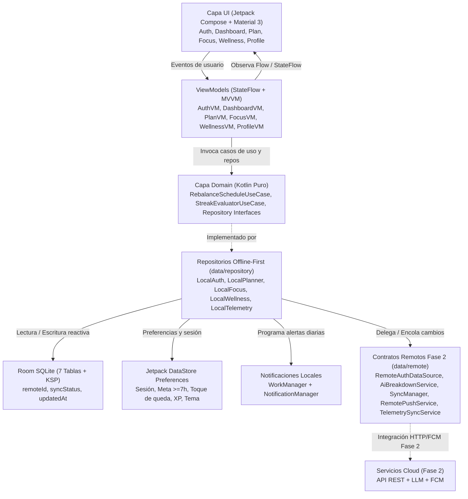

# Arquitectura del Sistema — MicroPlan Android (Offline-First)

**Proyecto:** Plataforma digital inteligente de microplanificación académica, gestión del enfoque y protección del descanso para estudiantes universitarios  
**Equipo 6 · Facultad de Ciencias de la Computación (BUAP)** — Entregable Técnico (Actividad A-24)  
**Paquete base:** `mx.buap.fcc.microplan` · **Versión:** `1.0.0` (Fase 1 Offline-First)

---

## 1. Visión General y Justificación Arquitectónica

La aplicación nativa **MicroPlan** ataca tres detonantes de alteración del sueño en estudiantes universitarios (18–25 años): la desorganización diurna frente a entregas complejas, la distracción por redes sociales durante el estudio y la *procrastinación vengativa de la hora de dormir* por ausencia de espacios de ocio diurno protegidos.

Para cumplir con los objetivos del proyecto —funcionar **100% en local en Fase 1** y habilitar la sincronización cloud e inteligencia artificial remota en **Fase 2** sin reescribir la UI ni las reglas de negocio— se adoptó una arquitectura **Offline-First + Clean Architecture + MVVM + Repository Pattern**:

- **Independencia de red en Fase 1:** toda escritura impacta inmediatamente la base local **Room (SQLite)** y **Jetpack DataStore**, ofreciendo latencia cero (< 16 ms) y resiliencia ante falta de Wi-Fi/datos en aulas universitarias.
- **Separación estricta de responsabilidades:** la capa `domain` contiene exclusivamente modelos puros y casos de uso en Kotlin (sin dependencias de Android ni Retrofit), permitiendo pruebas unitarias determinísticas en JVM.
- **Contratos listos para la nube (`data/remote/`):** cada servicio externo futuro (Autenticación, IA generativa, Sync bidireccional, Push FCM y Telemetría por lotes) está abstraído detrás de una interfaz Kotlin e implementado con stubs/servicios locales intercambiables desde `AppContainer`.
- **Inyección manual determinística (`AppContainer`):** evita sobrecarga de anotaciones o fallos de generación de código en entornos ligeros CLI sin Android Studio.

---

## 2. Diagrama de Capas y Flujo de Datos

### Diagrama Mermaid



### Diagrama ASCII (Referencia Rápida)

```text
+-----------------------------------------------------------------------------+
|                     CAPA UI (Jetpack Compose + Material 3)                  |
|   AuthScreen | DashboardScreen | PlanScreen | FocusScreen | Wellness | Prof |
+-------------------------------------+---------------------------------------+
                                      | StateFlow / Eventos
                                      v
+-----------------------------------------------------------------------------+
|                  VIEWMODELS + DI MANUAL (AppContainer)                      |
+-------------------------------------+---------------------------------------+
                                      |
                                      v
+-----------------------------------------------------------------------------+
|                      CAPA DOMAIN (Kotlin Puro / JVM)                        |
|  - Modelos: AcademicProject, Subtask, ProtectedBlock, StreakDayRecord...    |
|  - Casos de uso: RebalanceScheduleUseCase, StreakEvaluatorUseCase           |
|  - Interfaces: AuthRepository, PlannerRepository, FocusRepository, ...      |
+-------------------------------------+---------------------------------------+
                                      |
                                      v
+-----------------------------------------------------------------------------+
|                     CAPA DATA (Offline-First Repositories)                  |
|  LocalAuthRepositoryImpl | LocalPlannerRepositoryImpl | LocalFocusImpl ...  |
+----------+--------------------------+-------------------------+-------------+
           |                          |                         |
           v                          v                         v
+-------------------+     +-----------------------+   +-----------------------+
|  Room (SQLite)    |     | DataStore Preferences |   | Contratos data/remote |
|  7 Tablas + KSP   |     | Sesión, Sueño, XP,    |   | - RemoteAuthDataSource|
|  remoteId         |     | Tema Oscuro           |   | - AiBreakdownService  |
|  syncStatus       |     +-----------------------+   | - SyncManager         |
|  updatedAt        |                                 | - RemotePushService   |
+-------------------+     +-----------------------+   | - TelemetrySyncService|
                          | WorkManager + Notif.  |   +-----------+-----------+
                          | Alertas 10:30 / 11 PM |               | (Fase 2)
                          +-----------------------+               v
                                                      [ Backend REST / IA / FCM ]
```

---

## 3. Estructura de Paquetes y Responsabilidades

Raíz del código fuente: `app/src/main/kotlin/mx/buap/fcc/microplan/`

| Paquete | Archivos clave | Responsabilidad |
| :--- | :--- | :--- |
| `.` | `MicroPlanApplication.kt`, `MainActivity.kt` | Inicializa `AppContainer`, canales de notificación, semilla inicial (`SeedDataInitializer`) y monta `MicroPlanApp`. |
| `di` | `AppContainer.kt`, `SimpleViewModelFactory` | Contenedor manual de dependencias (Room, DataStore, casos de uso, servicios locales/stubs y repositorios). |
| `domain/model` | `Enums.kt`, `Models.kt`, `TimeFormatters` | Entidades de dominio puras, `SyncStatus`, `SleepRigidity`, `GamificationSummary` y formateo horario. |
| `domain/usecase` | `RebalanceScheduleUseCase.kt`, `StreakEvaluatorUseCase.kt` | Rebalanceo automático respetando bloques inmunes (`05:00 PM - 06:00 PM`) y horarios de clase, marcado `Carga Ajustada`, reprogramación nocturna y cálculo de XP/medallas/rachas. |
| `domain/repository` | `Repositories.kt` | Contratos `AuthRepository`, `PlannerRepository`, `FocusRepository`, `WellnessRepository`, `TelemetryRepository`. |
| `data/local` | `MicroPlanDatabase.kt`, `Converters.kt`, `EntityMappers.kt`, `UserPreferencesDataSource.kt`, `SeedDataInitializer.kt` | Persistencia Room (`exportSchema = true`), DataStore Preferences y precarga de datos demo BUAP. |
| `data/local/entity` | `Entities.kt` | 7 entidades SQLite con campos obligatorios de sincronización (`remoteId`, `syncStatus`, `updatedAt`). |
| `data/local/dao` | `Daos.kt` | 7 DAOs reactivos (`Flow`) con transacciones para actualización atómica de agenda. |
| `data/remote` | `RemoteAuthDataSource.kt`, `AiBreakdownService.kt`, `SyncManager.kt`, `RemotePushService.kt`, `TelemetrySyncService.kt` | Interfaces, DTOs `@Serializable` e implementaciones offline (`LocalHeuristicAiBreakdownService`, `LocalNotificationPushService`, stubs). |
| `data/repository` | `LocalAuthRepositoryImpl.kt`, `LocalPlannerRepositoryImpl.kt`, `LocalFocusRepositoryImpl.kt`, `LocalWellnessRepositoryImpl.kt`, `LocalTelemetryRepositoryImpl.kt` | Implementación offline-first de los repositorios conectando Room, DataStore, casos de uso y stubs remotos. |
| `notifications` | `NotificationHelper.kt`, `CurfewNotificationWorker.kt` | Canales Android (`microplan_sleep_hygiene`, `microplan_focus_alerts`) y worker periódico de `WorkManager`. |
| `ui/theme` | `Color.kt`, `Type.kt`, `Theme.kt` | Tokens de diseño Stitch Light (`#2563EB`, `#15803D`, `#0F766E`, `#B45309`, `#B91C1C`) y Dark Mode nocturno via `LocalMicroPlanColors`. |
| `ui/components` | `SharedComponents.kt` | `MicroPlanCard`, `StatusPill`, `ModuleTopBar`, `WeeklyStreakRow`, `TimeMinutesPickerDialog`. |
| `ui/auth`, `ui/dashboard`, `ui/plan`, `ui/focus`, `ui/wellness`, `ui/profile` | `*ViewModel.kt`, `*Screen.kt` | Implementación MVVM de las 6 pantallas y el `ModalBottomSheet` de fin de Pomodoro. |
| `ui/navigation` | `MicroPlanApp.kt` | Gestión de flujo Auth vs Shell con barra inferior de 5 pestañas (`Dashboard`, `Plan`, `Focus`, `Wellness`, `Profile`) y permiso `POST_NOTIFICATIONS`. |

---

## 4. Esquema Relacional Local (Room SQLite v1)

Base de datos: `microplan_offline.db` · Esquema exportado en `app/schemas/mx.buap.fcc.microplan.data.local.MicroPlanDatabase/1.json`.

> **Convención obligatoria Offline-First en las 7 tablas:**  
> Todas las entidades incluyen `remoteId: TEXT (nullable)`, `syncStatus: TEXT NOT NULL` (`LOCAL_ONLY`, `PENDING_SYNC`, `SYNCED`) y `updatedAt: INTEGER NOT NULL` (epoch ms).

### Tablas y Relaciones

1. **`local_users`**
   - **PK:** `id` (`TEXT`)
   - **Índice Único:** `index_local_users_email` (`email`)
   - **Columnas:** `fullName`, `email`, `passwordHash` (SHA-256), `careerGroup`, `initials`, `sleepGoalHours` (`REAL`), `disconnectAlertMinutes` (`INTEGER`), `curfewBedtimeMinutes` (`INTEGER`), `rigidity` (`TEXT`), `remoteId`, `syncStatus`, `updatedAt`.

2. **`projects`**
   - **PK:** `id` (`TEXT`)
   - **Columnas:** `title`, `courseName`, `dueDateEpochDay` (`INTEGER`), `categoryIcon` (`TEXT`), `isAiGenerated` (`INTEGER`), `createdAtEpochDay` (`INTEGER`), `remoteId`, `syncStatus`, `updatedAt`.

3. **`subtasks`**
   - **PK:** `id` (`TEXT`)
   - **FK:** `projectId` -> `projects(id)` (`ON DELETE CASCADE`)
   - **Índices:** `index_subtasks_projectId`, `index_subtasks_assignedEpochDay`
   - **Columnas:** `projectId`, `title`, `assignedEpochDay`, `scheduledSlotMinutes`, `scheduledSlotLabel`, `estimatedPomodoros`, `completedPomodoros`, `isCompleted`, `isOverCapacityAlert`, `sortOrder`, `remoteId`, `syncStatus`, `updatedAt`.

4. **`pomodoro_sessions`**
   - **PK:** `id` (`TEXT`)
   - **Índices:** `index_pomodoro_sessions_subtaskId`, `index_pomodoro_sessions_startedAtMillis`
   - **Columnas:** `subtaskId`, `subtaskTitle`, `durationMinutes`, `startedAtMillis`, `endedAtMillis`, `outcome` (`COMPLETED` | `EXTENDED` | `PAUSED_LOST_STREAK`), `remoteId`, `syncStatus`, `updatedAt`.

5. **`protected_blocks`**
   - **PK:** `id` (`TEXT`)
   - **Columnas:** `title`, `type` (`DAYTIME_LEISURE` | `CLASS_SCHEDULE` | `CUSTOM`), `daysLabel`, `startMinutes`, `endMinutes`, `description`, `tagsSerialized`, `isImmune` (`INTEGER`), `remoteId`, `syncStatus`, `updatedAt`.

6. **`streak_history`**
   - **PK:** `epochDay` (`INTEGER`)
   - **Columnas:** `completedTasksCount`, `respectedCurfew`, `emergencyUsed`, `streakMaintained`, `xpEarned`, `remoteId`, `syncStatus`, `updatedAt`.

7. **`telemetry_events`**
   - **PK:** `id` (`TEXT`)
   - **Índices:** `index_telemetry_events_syncStatus`, `index_telemetry_events_createdAtMillis`
   - **Columnas:** `eventType`, `payloadJson`, `createdAtMillis`, `remoteId`, `syncStatus`, `updatedAt`.

### Almacenamiento Complementario (`UserPreferencesDataSource`)

Archivo DataStore `microplan_preferences`: `is_logged_in`, `current_user_id`, `current_user_name`, `current_user_email`, `career_group`, `sleep_goal_hours`, `disconnect_alert_minutes`, `curfew_bedtime_minutes`, `sleep_rigidity`, `daily_pomodoro_capacity`, `dark_mode_enabled`, `xp_points`, `current_streak_days`, `today_curfew_resolved_day`, `emergency_active_today`, `seed_initialized`.

---

## 5. Guía y Contratos para Conexión a Internet (Fase 2)

En la Fase 2 **no es necesario modificar las pantallas Compose ni los ViewModels**. Bastará con agregar un cliente HTTP (`Retrofit` o `Ktor`) + dependencia de Firebase Cloud Messaging si aplica, e intercambiar las implementaciones registradas en `di/AppContainer.kt`.

### Matriz de Migración Fase 1 -> Fase 2

| Módulo | Interfaz / Stub actual (`data/remote/`) | Qué conectar en Fase 2 | Archivos a modificar |
| :--- | :--- | :--- | :--- |
| Autenticación | `RemoteAuthDataSource` / `StubRemoteAuthDataSource` | Login/Registro JWT y refresh token | `RemoteAuthDataSource.kt`, `LocalAuthRepositoryImpl.kt`, `AppContainer.kt` |
| Desglose con IA | `AiBreakdownService` / `LocalHeuristicAiBreakdownService` | Backend proxy hacia LLM (p. ej. Gemini API) con fallback local si no hay red | `AiBreakdownService.kt`, `AppContainer.kt` |
| Sincronización | `SyncManager` / `OfflineStubSyncManager` | Push/Pull incremental por `updatedAt` y `syncStatus != SYNCED` | `SyncManager.kt`, `Daos.kt` (queries pending), `AppContainer.kt` |
| Notificaciones Push | `RemotePushService` / `LocalNotificationPushService` | Mantener `WorkManager` local como respaldo + registro de token FCM remoto | `RemotePushService.kt`, nuevo `FirebaseMessagingService`, `AndroidManifest.xml` |
| Telemetría Piloto | `TelemetrySyncService` / `OfflineTelemetrySyncServiceStub` | Envío por lotes de `telemetry_events` y marcado `SYNCED` al confirmar 200 OK | `TelemetrySyncService.kt`, `Daos.kt`, `AppContainer.kt` |

---

### Contratos REST / JSON Propuestos (Base URL: `https://api.microplan.buap.mx/v1`)

#### A. Autenticación (`RemoteAuthDataSource`)
- **`POST /auth/login`**
  - Request DTO (`RemoteAuthRequestDto`):
    ```json
    {
      "email": "estudiante@correo.edu.mx",
      "password": "********"
    }
    ```
  - Response DTO (`AuthTokenResponseDto`):
    ```json
    {
      "accessToken": "eyJhbGciOi...",
      "refreshToken": "def50200...",
      "userId": "usr_8f12a",
      "fullName": "Angel García",
      "email": "estudiante@correo.edu.mx",
      "careerGroup": "Ciencias de la Computación · Grupo Piloto"
    }
    ```
- **`POST /auth/register`** -> Consume `RemoteRegisterRequestDto` (`fullName`, `email`, `password`, `sleepGoalHours`, `disconnectAlertMinutes`) y devuelve `AuthTokenResponseDto`.

#### B. Desglose Inteligente de Tareas (`AiBreakdownService`)
- **`POST /ai/breakdown`**
  - Request DTO (`AiBreakdownRequestDto`):
    ```json
    {
      "activityPrompt": "Ensayo final de neurobiología sobre plasticidad sináptica",
      "dailyPomodoroCapacity": 4,
      "availableDaysBeforeDeadline": 4,
      "preferredEndHour24": 19
    }
    ```
  - Response DTO (`AiBreakdownResponseDto`):
    ```json
    {
      "projectTitle": "Ensayo final de neurobiología sobre plasticidad sináptica",
      "suggestedCourse": "Seminario de Investigación",
      "recommendedDeadlineDays": 4,
      "categoryHint": "BOOK",
      "sourceMode": "CLOUD_LLM",
      "subtasks": [
        { "title": "Delimitar tesis y fuentes académicas", "dayOffset": 0, "estimatedPomodoros": 2 },
        { "title": "Estructurar esquema de argumentos y citas", "dayOffset": 1, "estimatedPomodoros": 2 }
      ]
    }
    ```

#### C. Sincronización Bidireccional (`SyncManager`)
- **`POST /sync/delta`**
  - Request JSON (registros locales con `syncStatus != SYNCED`):
    ```json
    {
      "lastSyncedAtMillis": 1795520000000,
      "projects": [],
      "subtasks": [],
      "pomodoroSessions": [],
      "protectedBlocks": [],
      "streakHistory": []
    }
    ```
  - Response JSON: devuelve mapa de `localId -> remoteId`, `serverTimestampMillis` y cambios remotos para aplicar upsert en Room marcando `syncStatus = "SYNCED"`.

#### D. Registro Push FCM (`RemotePushService`)
- **`POST /devices/fcm-token`**
  - Request JSON: `{ "platform": "android", "fcmToken": "cX9z..." }`
  - Payload compatible con `PushNotificationPayloadDto`: `{ "title": "...", "body": "...", "category": "SLEEP_CURFEW" }`.

#### E. Telemetría del Programa Piloto (`TelemetrySyncService`)
- **`POST /telemetry/batch`**
  - Request DTO (`TelemetryBatchDto`):
    ```json
    {
      "devicePlatform": "android",
      "appVersion": "1.0.0",
      "events": [
        {
          "eventId": "evt-a1b2c3",
          "eventType": "CURFEW_RESCHEDULE_SLEEP",
          "payloadJson": "{\"movedTasks\":1,\"newStreak\":6}",
          "createdAtMillis": 1795543200000
        }
      ]
    }
    ```
  - Response DTO (`TelemetrySyncResponseDto`): `{ "acceptedCount": 1, "serverTimestampMillis": 1795543201000 }`.
